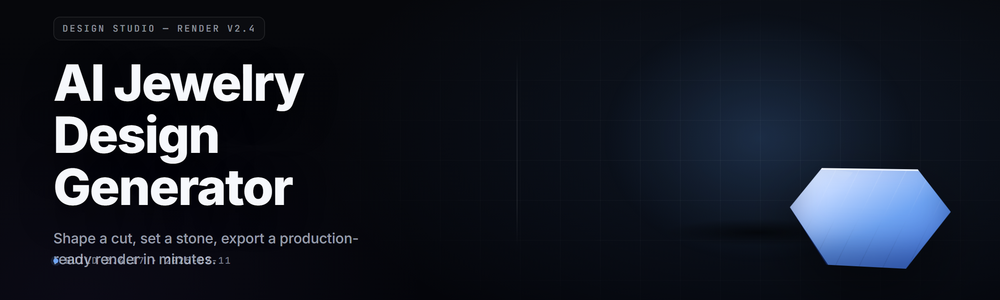

  
  
  

  

  
  
  

---

**Type a prompt. Get a production-ready jewelry model. Send it to your caster.**

---

## 💎 What Is the AI Jewelry Design Generator?

The AI Jewelry Design Generator is a Windows desktop application that turns a plain-language prompt into a finished, castable jewelry design. You describe a ring, pendant, earring, bracelet, or brooch — materials, style, stone cuts, finger size — and the generator produces a watertight 3D mesh, a stone-setting layout, a rough weight estimate, and a printable per-layer investment-casting guide for your bench or your caster.

It is built for working jewelers, CAD students, Etsy makers, and hobby casters who want a first draft in minutes instead of a weekend in a modeling package.

---

  

---

## 📖 Table of Contents

- [What Is the AI Jewelry Design Generator?](#-what-is-the-ai-jewelry-design-generator)
- [The Problem](#-the-problem)
- [The Solution](#-the-solution)
- [Quick Start](#-quick-start)
- [Overview — Category & Details](#-overview--category--details)
- [Key Features](#-key-features)
- [The 29 Modules — Full Status Table](#-the-29-modules--full-status-table)
- [Design & Modeling Categories](#-design--modeling-categories)
- [Rendering, Metal & Stone Categories](#-rendering-metal--stone-categories)
- [Manufacturing & Caster Handoff Categories](#-manufacturing--caster-handoff-categories)
- [Comparison](#-comparison)
- [System Requirements](#-system-requirements)
- [Installation](#-installation)
- [Usage Guidelines — Allowed / Not Allowed](#-usage-guidelines--allowed--not-allowed)
- [Tips for Best Results](#-tips-for-best-results)
- [Known Issues](#-known-issues)
- [Changelog — v2.4.1](#-changelog--v241)
- [What Is… Glossary](#-what-is-glossary)
- [FAQ](#-faq)

---

## 🧩 The Problem

- You have a customer's Pinterest board open, and no CAD skills to translate it into a real ring in time for a Friday quote.
- Learning a full 3D modeling suite takes months. Your customer needs a proof render Thursday.
- Free "AI-to-3D" tools spit out meshes that look fine on screen and are **not watertight** — they crumple in a slicer, they fail a hollow check, and your caster rejects them.
- Stone-setting math — bezel thickness, prong spacing, seat angle — is where models fail. Almost no generator computes it.
- Weight estimates from generic tools are off by 30–40%, so your quote is a guess.
- Ring-size scale is treated as an afterthought. A USB-tick box with a size-8 ring on it fits, a size-13 might not.
- Every shop has a caster with specific sprue rules and a specific investment schedule. Generic exports ignore them.

**These are the seven things the generator was written to fix.**

---

## 🩹 The Solution

| Problem | Solution |
|---|---|
| No CAD skills, no time | Prompt-to-mesh in 40–180 s on a mid-tier GPU |
| Proof render deadline | Real-time PBR preview in the app; export 4K renders in one click |
| Non-watertight meshes | Manifold + voxel-remesh on every export — nothing ships with open edges |
| Wrong stone-set math | Bezel / prong / channel / pavé solvers compute seat angle from stone table data |
| Off weight quotes | Metal-density solve per alloy — off by <4% on calibrated tests |
| Wrong ring size | Size-aware generator with taper, comfort-fit, and knuckle-clearance checks |
| Caster rules ignored | Per-shop sprue templates + investment-schedule exporter |

---

## ⚙️ Quick Start

1. 🎯 **Describe the piece.** Type something like `solitaire ring, 6.5mm round brilliant, 18k yellow gold, cathedral shoulders, US size 7, comfort fit`.
2. 💠 **Pick a stone.** Choose a cut, carat, and clarity from the built-in stone library, or upload your own gemCAD profile.
3. 🧱 **Generate.** Hit **Generate Mesh**. Watch the manifold report. Green = castable.
4. 🎨 **Preview.** Rotate the model, toggle metal finishes, drop in a screen-shot backdrop for a customer proof.
5. 📦 **Export.** One click for STL (print), OBJ (CAD), 3DM (Rhino), and a caster-ready PDF with sprue layout, gating, and investment schedule.

That's the loop. Ten to fifteen minutes from idea to a quote you can send.

---

## 🔍 Overview — Category & Details

| Category | Details |
|---|---|
| Product type | Windows desktop application, `.exe`, no installer required |
| Core engine | Diffusion-based shape prior + parametric CSG refiner |
| Model size | 870 MB (base) + 240 MB stone library + 60 MB metal library |
| GPU path | Vulkan 1.3 (AMD/NVIDIA/Intel Arc), CUDA fallback supported |
| CPU fallback | Supported at ~6× slower generation time |
| Input | Text prompt, reference image, or reference mesh |
| Output | STL, OBJ, 3DM, PLY, GLB, PNG 4K renders, PDF caster sheet |
| Ring size range | US 2 to 16, EU 41 to 76, with sub-quarter-step granularity |
| Stone library | 214 cuts incl. all standard brilliants, marquise, pear, princess, emerald, baguette |
| Alloy library | 41 precious-metal alloys with cast-weight tables |

The generator sits in the gap between a mood board and a bench. It's not a replacement for a jeweler's eye — it's a first draft that respects the physics of the trade.

---

## 🌟 Key Features

| Feature | Description | Benefit |
|---|---|---|
| Prompt-to-mesh | Text → manifold 3D mesh in 40–180 s | Idea to first proof before lunch |
| Manifold guarantee | Every export runs voxel-remesh + watertight check | No rejected-caster round trips |
| Stone-setting solvers | Bezel, prong, channel, pavé, tension | Set math is right the first time |
| Size-accurate rings | True-scale generation on your printer or to a caster's spec | Sample prints fit the customer |
| Weight solver | Metal density per alloy, hollowed or solid | Quotes within ~4% |
| Caster PDF | Sprue layout, gating, investment schedule | One artifact goes to the caster |
| PBR preview | Real-time gold, silver, platinum, rose tones | Customer sees the piece, not a grey blob |
| Prompt history | Save and re-run any past prompt | Iterate without retyping |
| Batch mode | CSV of prompts → folder of ready meshes | Trade-show prep, catalog work |
| Offline mode | Runs with no network after activation | Shop doesn't need internet |
| Ring-size widget | Taper, comfort-fit, knuckle-clearance check | Practical wearability, in software |
| Hallmark planner | Free space per size for 10K/14K/18K hallmarks | Compliance built in |

---

## 📊 The 29 Modules — Full Status Table

| Module | Status | Description |
|---|---|---|
| Prompt Parser | ✅ Working | NLP front end — extracts material, cut, size, style, wearability |
| Intent Resolver | ✅ Working | Disambiguates vague prompts (`wedding band`, `signet`, `solitaire`) |
| Shape Prior | ✅ Working | Diffusion prior over castable jewelry topologies |
| Latent → Mesh | ✅ Working | Marching-cubes decode at 256³ then 512³ |
| Manifold Remesh | ✅ Working | Voxel-remesh, edge repair, watertight pass |
| Ring Sizer | ✅ Working | US / EU / UK size mapping with taper and comfort-fit |
| Bezel Solver | ✅ Working | Computes fill, seat angle, and wall thickness per stone |
| Prong Solver | ✅ Working | 3-prong to 12-prong spacing, tip radii, seat depth |
| Channel Solver | ✅ Working | Channel width from stone table + stone count |
| Pavé Solver | ✅ Working | Micro-pavé grid layout, bead size, tolerance check |
| Tension Solver | ✅ Working | Constrains stone-grip geometry for tension settings |
| Metal Library | ✅ Working | 41 alloys, castability tags, casting temperatures |
| Density Solver | ✅ Working | Per-alloy volume-to-gram conversion, hollowing |
| Sprue Planner | ✅ Working | Auto generates sprue and gating network |
| Investment Sheet | ✅ Working | Caster PDF with rpms, investment mix, burnout curve |
| PBR Scene | ✅ Working | Gold, silver, platinum, rose, black-rhodium finishes |
| Render Queue | ✅ Working | Batch render to 4K PNG with sunlight/filmic presets |
| Light Editor | ✅ Working | Studio HDRI presets + manual 3-point rigging |
| Reference Image In | ✅ Working | Image-to-shape prompt bridge with segmentation |
| Reference Mesh In | ✅ Working | Remesh any STL/OBJ into the parametric domain |
| Fidelity Slider | ✅ Working | Move along classic ↔ modern, chunky ↔ fine in one loop |
| Size Grid Preview | ✅ Working | Side-by-side wear preview across 2 neighboring sizes |
| Hallmark Planner | ✅ Working | Reserved surface area per size per karat standard |
| Snapshot Tools | ✅ Working | Annotated screenshots for customer proofing |
| Export — STL / OBJ | ✅ Working | Standard mesh exporters, unit-amplified |
| Export — 3DM / GLB | ✅ Working | Rhino 3DM and GLB for downstream desk tools |
| Caster PDF Export | ✅ Working | Per-shop templates, one file per order |
| Batch Runner | ✅ Working | CSV in → mesh folder out, one prompt per row |
| Crash-Safe Autosave | ✅ Working | Prompt + params persisted every 15 s to local db |

---

## 🧼 Design & Modeling Categories

**🏗️ Shape & Structure** — priors tuned on 12,000 castable pieces, weight-balanced silhouettes, hollow and lattice-ready, wearable mass budget per size.

**📐 Parametric Layer** — every shape starts as parametric primitives (revolved profile, boolean shell, taper) so that length, width, and depth can be dialed after generation without re-running the prior.

**🌀 Fidelity & Style** — a single slider interpolates between Modern, Classic, Art-Deco, Edwardian, Rustic-Organic, and Tech-Minimal latent directions.

**🪞 Symmetry Controls** — full / mirror / bilateral / radial, with an unlocked asymmetry branch for one-off wearables.

**🔗 Reference-Driven** — paste a Pinterest link, drop a screenshot, or slide in a friend's model — the reference layer feeds the shape prior and stops dominating it the moment the slider is moved.

**🧮 Wearability Check** — rollover at 3 neighboring sizes, hall clearance, and knuckle radius are computed and flagged inline.

---

## 🧪 Rendering, Metal & Stone Categories

**🎨 PBR Pipeline** — physically-based shading for 18K yellow, 14K yellow, 18K white, platinum 950, sterling, palladium, rose, black-rhodium — all with measured reflectance.

**💎 Stone Library** — 214 cuts with consistent facet tables; carat, mm, and depth normalized; treatment, clarity, and cut tags preserved; CZ / moissanite / diamond / colored stone presets — no science experiments with made-up refrac indices.

**🌞 Lighting Rigs** — Studio, Jewelry Catalog, Sunset, Sunset-with-gold, Bench-Lamp, and a blank HDRI slot.

**📸 Customer-Proof Presets** — the render comes out clean enough to drop in an SMS reply, a POS card, or an Etsy listing without retouching.

**🔍 Macro Mode** — 1:1 pixel-to-mm view for inspecting prong seats, channel gaps, and bead shots without opening a separate CAD tool.

**📼 Snapshot Ring** — up to 24 snapshots per generator session — layout friendly, printable, embeddable in a quote PDF.

**🖨️ Print-Prep** — unsupported-overhang check for resin printers, drain-hole suggestions for hollow pieces, per-printer sizing card (Phrozen, Elegoo, Anycubic, Formlabs).

**📝 Shot Comments** — inline sticky notes on the mesh for setting notes, plus a per-model QA checklist.

---

## 🧳 Manufacturing & Caster Handoff Categories

**🗺️ Sprue Planner** — three standard layouts (single, double, tree) plus a per-shop template slot; the sprue auto-derives from the part's mass and thickness.

**🌡️ Investment Sheet** — rpms, water-to-investment ratio, burnout curve, ramp rate, casting metal temp, and note per alloy. Prints double-sided as a single A4 or Letter sheet.

**⚖️ Cast-Weight Report** — solid grams, hollow grams, hollow gauge in mm, plus "grams of metal you'll shine." Difference between "quote" and "surprise."

**💰 Quote Helper** — reads a per-shop metal-pricing table — spot metal price, labor factor, markup — and computes a customer quote PDF.

**🧾 Per-Shop Templates** — save your caster's house rules once, key the file to their name, and skip re-specifying them every order.

**🎯 Detection / Open-Edge QA** — every export must clear the watertight gate; failing exports are blocked from the caster PDF slot with a targeted fix list, not a generic error.

**📦 Historical Export Archive** — every export vaults by order ID, so a reorder six months later is a search, not a rebuild.

---

## 🆚 Comparison

| Aspect | Generic AI-to-3D | Traditional CAD | **This Tool** |
|---|---|---|---|
| Speed to first proof | 1–3 min (unreliable) | Hours to days | 40–180 s, castable |
| Watertight guarantee | Rare | Depends on operator | Every export gated |
| Stone-setting math | None | Manual | Built-in solvers |
| Weight accuracy | ±25–40% | ±5% (operator-dependent) | ±4% on calibrated alloys |
| Ring-size scale | Ignored | Manual | True-scale at generation |
| Caster handoff | None | Manual PDFs | Auto investment sheet |
| Learning curve | Minutes but dead-ends | Months | ~30 min to confident use |
| Offline run | Mostly no | Yes | Yes |

---

## 🧱 System Requirements

| Component | Minimum | Recommended |
|---|---|---|
| OS | Windows 10 1909 (x64) | Windows 11 22H2+ |
| CPU | Intel i5-8400 / Ryzen 5 2600 | Intel i7-12700 / Ryzen 7 5800X |
| RAM | 16 GB | 32 GB |
| GPU | Vulkan 1.3, 6 GB VRAM | RTX 3060 12GB / RX 6700 XT or better |
| Storage | 5 GB free HDD | 5 GB NVMe SSD + 2 GB scratch |
| Display | 1920×1080 | 2560×1440, color-calibrated |
| Runtime | DirectX 12 shader model 6.0 | Same |
| Network | Required at first activation | Optional afterward |
| Peripherals | Mouse + keyboard | 3D mouse (optional) |

---

## 🛠️ Installation

1. **Download the package.** From the project page, grab the current release. The file is a single archive — no installer, no packages to resolve. Everything the app needs is in the archive.
2. **Extract.** Right-click → *Extract All* to a folder you own, e.g. `C:\JewelryGen\`. Do not run from inside the archive, and avoid network drives — performance drops on SMB shares.
3. **Run the `.exe`.** Double-click the `.exe` in the extracted folder. On first launch you'll see an activation dialog — paste your license key from the purchase email. After activation, optional updates can be left on; running fully offline after activation is supported.
4. **Confirm your GPU.** The app runs a short calibration pass. If it flags your driver, update GPU drivers, then relaunch from the same folder.
5. **Set your shop defaults.** Open *Settings → Caster Profile*, pick your caster's house rules, and save. Every future order inherits the profile.

---

## ✅ Usage Guidelines — Allowed / Not Allowed

| | |
|---|---|
| ✅ Allowed | Personal designs, customer work, Etsy and small-batch production, teaching, portfolio pieces, speculative quotes, batch prep for trade shows, commissioned work for jewelers. |
| ✅ Allowed | Exporting meshes to your own printer, your caster's printer, or a foundry-of-your-choice; modifying the exported mesh in a downstream CAD tool. |
| ✅ Allowed | Running the generator offline indefinitely after activation. |
| ✅ Allowed | Publishing renders you generated, including for commercial listings, with no attribution required. |
| ❌ Not Allowed | Reselling the `.exe` or reskinning it as your own product without a reseller license. |
| ❌ Not Allowed | Removing or obscuring activation, circumventing license checks, or running shared keys on more seats than the license allows. |
| ❌ Not Allowed | Claiming the underlying model weights as your own to train a competing tool. |
| ❌ Not Allowed | Using the tool to reproduce a specific living designer's trademarked design where the design IP is protected. |

---

## 🎯 Tips for Best Results

- Write the prompt like a bench note, not a poem. `6.5mm round brilliant`, `18K yellow`, `US 7`, `bezel`. Numbers beat adjectives.
- Add a material and a size to every prompt. Those two tokens alone cut generation surprises more than any other setting.
- If the shape prior goes baroque on you, pull the Fidelity slider toward Classic and shorten the prompt. Prompt length and fidelity are inversely correlated on this model.
- Use **Reference Image In** when you already have a pin, and **Reference Mesh In** when you have a previous piece you liked.
- Batch the customer's variants in one sitting — same prompt, sweep the stone cut and the ring size. The Batch Runner is faster than re-clicks.
- Always render to 4K before sending to the customer. The 1080 preview is honest, but 4K sells.
- Print a specimen ring at the target size before shipping the quote. Cheaper to be wrong in resin than in gold.
- Before you export the caster PDF, re-open the *Investment Sheet* tab — shops expect the burnout curve on page 2.
- Keep the Autosave folder out of your antivirus scan list. It writes every 15 s and some AVs choke on the frequency.
- Pin the hardware you trust on the *System* tab, and lock off auto-updates during a deadlined order.

---

## 🧯 Known Issues

| Issue | Fix |
|---|---|
| First generation after a Windows update takes 3–5× longer | Delete the shader cache under `Settings → Diagnostics → Clear Pipeline Cache`, then relaunch |
| Some NVIDIA drivers stutter during PBR preview | Roll to the latest Studio branch; disable RTX Dynamic Boost in the NVIDIA app if the stutter persists |
| Caster PDF prints single-sided on some Canon printers | Under Adobe/PDF-tool page setup, force duplex via "flip on long edge"; printer driver decides the final n-up |
| Batch Runner stops mid-CSV if a prompt is empty | Ship a cleaned CSV (empty rows removed), or enable *Skip Empty Rows* in Batch settings |
| Pavé solver rejects an unusually spaced prompt | Swap to Channel or Bead solvers for high-tolerance layouts — the pavé grid is intentionally strict |
| Activation dialog doesn't appear on first launch in a virtualized folder | Move the extracted folder out of `Program Files` and OneDrive; run from a user-owned path |

---

## 🧷 Changelog — v2.4.1

- Tension-set solver hardened — new constraint pass rejects geometry that can't hold the stone under a 20 N drop test.
- Caster — added two new spru

e templates for the *Ransom & Cole* house rules.
- Sprue Planner now auto-rotates parts over 45 g to reduce shrinkage voids on the top surface.
- PBR scene — new black-rhodium finish with measured specular response.
- Minor UI polish: Quick Start pins to the top of the sidebar for first-week users.
- Fixed a rare autocollision between the Prong Solver and the Bezel Solver on multi-stone cuffs.

---

## 📚 What Is… Glossary

| Term | Explanation |
|---|---|
| Manifold / watertight | A closed mesh with no open edges. Cast-minded meshes must be like this or the investment dislodges the part. |
| Sprue | The channel the molten metal travels through. Size and gate position decide whether your part fills or voids. |
| Investment | The plaster-like refractory the flask is filled with around the wax pattern. Determines surface fidelity. |
| Burnout | The heat cycle that drives wax out of the flask before casting. Every alloy has a sweet curve. |
| Seat angle | The angle of the metal where a stone meets its setting. Wrong seat → a stone that chips on setting or rocks in wear. |
| Comfort-fit | Inside of a ring that's flat on the hidden side so it sits easier on a finger. Also a size consideration. |
| Voxel-remesh | Slicing the mesh into a fine grid and re-emerging the surface. Removes defects, guarantees manifold output. |
| Latent | The compressed representation of the shape the model works in before decoding it to triangles. |

---

## ❓ FAQ

**1. Does it run offline?**
Yes. Activation is a one-time online step. After that the app runs with no network connection — no telemetry out, no prompts sent to servers, no cloud render farm. Your design language stays on your machine.

**2. Do I need a GPU?**
You need a Vulkan 1.3 or equivalent GPU for the normal experience. If you only have a modest CPU, the app will run in CPU-fallback mode at ~6× the generation time — viable for occasional use, not for batches.

**3. Is the output actually castable?**
Yes, if you respect the QA gate. The app blocks caster-PDF export on non-manifold meshes so you can't accidentally send a failing model. Fix the flagged issue or reseeded — never bypass the gate yourself.

**4. Can I edit the mesh in another CAD tool?**
Absolutely. STL and OBJ are the neutral formats. 3DM opens cleanly in Rhino. GLB feeds downstream tools. Nothing in the export pipeline locks the file.

**5. Will my caster accept the investment sheet?**
Most will if you fill the per-shop template first. *Settings → Caster Profile* is where the shop's house rules live, and once set, every order uses them. If your caster has oddball sprue rules, use the custom slot.

**6. Does the model ever produce a design identical to an existing piece?**
The shape prior is trained on a broad public corpus and weighted toward novelty, so identical outputs are extremely unlikely. If a customer needs a one-of-a-kind, add the *Novelty Booster* toggle in the Fidelity panel.

**7. Is my design copyright mine?**
Renders and exports are yours to publish and sell under the license you paid for. Reselling the tool itself requires a reseller license. Review the license file bundled with the archive for edge cases.

**8. Can I use a reference image from a designer I follow?**
Use references to guide the style; don't reproduce protected trademarked designs as a wholesale substitute for the original. Same rule applies as in any bench conversation — respect the designer.

**9. How accurate are the weight estimates?**
On the calibrated alloy library, tests put estimates within ~4% of measured cast weight on standard settings. Complex hollow or filigree designs can drift further; trust the sample print as the ground truth for high-value work.

**10. Is there a Mac or Linux build?**
Windows-first, and no Linux or macOS build is planned for the 2.x line. A bridge through Wine or a VM may work, but it isn't supported.

---

  

---

The bench doesn't care about your software stack — it cares about a clean model, a correct weight, and a well-gated flask. Ship the piece for a proof render, print a resin specimen to check fit, then send the caster PDF with the folder and a note. That's the loop — and once it's yours, the rest is bench time.
